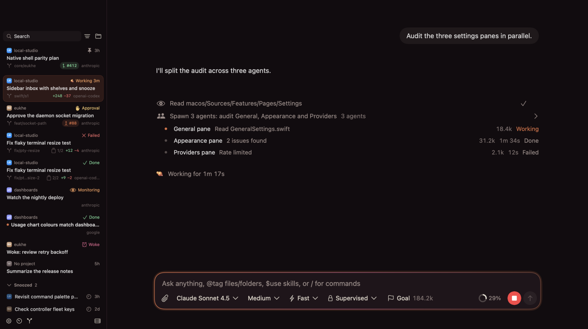
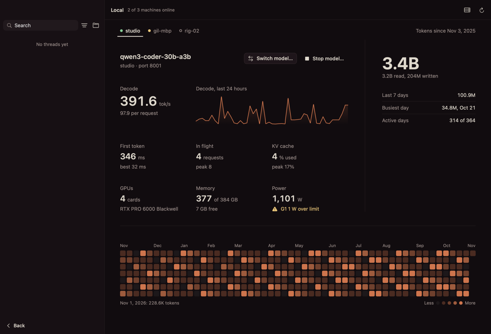

<p align="center"></p>

# Local Studio

**The native studio for coding agents and local AI.** Run every agent thread you have, across every project, on your own GPUs or any cloud model, in one fast Mac and Linux app that never stops working when you close the window.



*Rendered from the app's own fixture scenes (`LocalStudio +snapshot`).*

## Why Local Studio

- **Native, not a web page in a frame.** AppKit and SwiftUI on macOS, GTK4 and libadwaita on Linux, over one Rust core. Terminals run on [libghostty-vt](https://lib.ghostty.org) emulation and grammar-based highlighting in the core, drawn natively by each app. On macOS every action works from the keyboard.
- **Threads that outlive the window.** Sessions run in the [Eukhe](https://github.com/gildrb/eukhe) daemon. Quit the app or crash it mid-turn: the turn keeps going, and the transcript is there when you come back.
- **Your own hardware, first class.** The Local page is a live dashboard for every machine in your fleet: decode speed, first-token time, KV cache, GPUs, memory, power, and a year of daily tokens. Switch or stop the model from the same page. The controller finds vLLM, SGLang, llama.cpp, ExLlama, Ollama and LM Studio engines for you.
- **Every model in one picker.** Built-in providers, any OpenAI-compatible, OpenAI Responses or Anthropic endpoint, and the engines on your own machines, side by side. Paste API keys or add an endpoint in Settings → Providers; Claude Code and Codex threads run through their official CLIs.
- **One inbox for all of it.** Every thread in every project, with live status: working, needs approval, failed, done. Snooze, pin, and see the branch, the diff size and the pull request on each row.
- **Plugins that do real work.** A plugin is a folder, usually a git tree, with a `plugin.toml`: skills, slash commands and its own tool server, each capability granted by you. See [Plugins](#plugins).



## Install

Local Studio ships on three channels. Stable opens with the first public release, and the first nightly ships once the nightly gate passes; today the only prebuilt build is dev.

| Channel | For | Updates |
| --- | --- | --- |
| Stable | Everyone | When a nightly has run clean for 72 hours and passed its live checks |
| Nightly | People who want new work first | Once a day, only from a commit that passed CI and the real-model checks |
| Dev | Developers and agents testing a change | Every merge to `main` |

Stable and nightly install side by side and share your threads. Dev keeps its own data. The full scheme is in [docs/channels.md](docs/channels.md).

**Nightly, macOS on Apple Silicon or Linux x86_64:**

```sh
curl -fsSL https://raw.githubusercontent.com/baney75/local-studio/main/scripts/install.sh | bash -s -- --channel nightly
```

The script reads the channel's feed, checks the download's sha256 and its signature against the channel key built into the script, installs it (`/Applications` on macOS, `~/.local` on Linux) and opens it. Checking the signature needs minisign, OpenSSL 3 or python3. Use `--channel stable` or `--channel dev` for the other channels. After that the app keeps itself current: it checks its own channel every 6 hours, downloads and verifies the update, and shows **Update** in the window and **Restart to Update** in Settings → General. Turn off Automatic updates there to download by hand.

Nightly and dev macOS builds are signed with the project's own certificate and are not notarized, so install them with the script, which checks them first. Stable is notarized.

**Linux (dev channel) by hand:** download `local-studio-linux-x86_64.tar.gz` from the [dev release](https://github.com/baney75/local-studio/releases/tag/dev). Dev keeps its own data, so threads made there do not carry over to nightly or stable.

**From source, macOS:**

```sh
nu macos/build.nu --configuration Release
open macos/build/Release/LocalStudio.app
```

Needs macOS 26 on Apple Silicon, Xcode 26+, Rust 1.98 and Nushell. The build fetches the pinned Eukhe release and checks it against its `SHA256SUMS`.

**From source, Linux:** `cd linux && cargo build`, then `nu bundle.nu`. Details in [linux/AGENTS.md](linux/AGENTS.md).

## Use

Add a project folder and start a thread.

| Keys | Does |
| --- | --- |
| ⌘N / ⌘T | New thread / new thread in this project |
| ⌘W | Close the thread |
| ⌘K | Command palette |
| ⌘J | Terminal |
| ⌥⌘B | Right panel |
| ⌃Tab | Recent threads |
| F6 or ⌘⌥←/→ | Move between sidebar, timeline, composer, panel and terminal |
| ⌘L | Focus the composer |
| ⌘, | Settings |

Settings → General → Keyboard turns on vim keys (j/k, gg/G, h/l, / and a modal composer).

## Plugins

A Local Studio plugin is a folder, usually a git tree, with a `plugin.toml` at its root:

```toml
id = "smoothstone"
version = "0.1.0"
description = "Make 3D printable parts with the stone CLI and its tested parametric recipes"
capabilities = []

[[commands]]
name = "stone"
description = "Make a printable part with smoothstone"
skill = "smoothstone"
```

What a plugin can do today:

- Ship skills and slash commands that appear in the composer.
- Run its own MCP tool server for your sessions (`mcp-server`).
- Declare each power it needs: `ask-user`, `native-host`, `site-secrets`, `accessibility`, `synthetic-input`, `screen-capture`. A plugin's tool server does not start until you have granted every one it asks for. The in-app consent sheet is being designed; today grants are made from the command line.
- Install from a pinned catalog entry: a git URL, a full commit and a `sha256` of the tree, so what runs is exactly what was reviewed. Installs from a path or an unpinned git source are not pinned, and grants are not yet bound to the installed tree (#38).

The plugin family, in progress:

| Plugin | What it is | State |
| --- | --- | --- |
| [Tychicus](https://github.com/baney75/tychicus) | Browser use and computer use for your agents | Ships Local Studio manifests today; becoming the default plugin |
| [Hildegard](https://github.com/baney75/hildegard) | Your own AI studio: images, film and voices on your own GPU, plus music and sound | Ships a Local Studio manifest with six commands; joining the catalog |
| [Gantrel](https://github.com/baney75/Gantrel) | Local-AI 3D design, from printable parts to slicing and printing | In the bundled catalog |
| [UntoCaesar](https://github.com/baney75/UntoCaesar) | Local-AI tax filing that never leaves your machine | Engine and manifest on a branch |
| [Corunis](https://github.com/baney75/Corunis) | A private organizational brain for universities | MCP server and manifest on a branch |
| [Fonsviva](https://github.com/baney75/Fonsviva) | Local compute and model serving the plugins run on | In progress |

From the command line:

```sh
local-studio plugin validate <dir>
local-studio plugin install <catalog id, path or git source>
local-studio plugin grant <id> <capability>...
local-studio plugin list
```

Write your own: start from [examples/plugins/smoothstone](examples/plugins/smoothstone).

## How it is built

- `core/`: the shared Rust core both apps link: inbox, transcripts, git, files, terminals, usage, plugins, settings.
- `kit/`: the core as a static library with Swift bindings (UniFFI).
- `macos/`: the macOS app. `linux/`: the Linux app. `ios/`: the iPhone app, in progress.
- `controller/`: the local-LLM controller. Discovers inference engines, links machines into a fleet, launches registry recipes. See [docs/controller.md](docs/controller.md).
- Eukhe is the agent engine, the way libghostty is Ghostty's terminal: sessions, storage, tools and inference live there, out of process.

Every check drives the real binaries against a real model. See [AGENTS.md](AGENTS.md).

## Limits

- macOS 26+ on Apple Silicon and Linux. Windows builds the core only, for now.
- Not sandboxed: agents run code with your user's permissions. Use Supervised mode to approve each step.
- Subscription sign-in for ChatGPT and GitHub Copilot happens in Eukhe (`eukhe`, then `/login`). Claude runs only through Claude Code and your `claude` sign-in ([docs/harness.md](docs/harness.md)); Local Studio hides Eukhe's Claude sign-in because it identifies as Claude Code and can get the account restricted. Anthropic API keys still work in Eukhe.

## Credits

Local Studio stands on the work of others, and gladly says so.

- [Eukhe](https://github.com/gildrb/eukhe), the agent core, and the native rework this repository grew from: Gil Rodrigues ([gildrb.com](https://gildrb.com)).
- The original Local Studio: Sherif Cherfa ([0xSero](https://github.com/0xSero)) and [contributors](https://github.com/sybil-solutions/local-studio/graphs/contributors).
- [T3 Code](https://github.com/pingdotgg/t3code) by T3 Tools: the original app and layout Local Studio began from.

## License

MIT. See [LICENSE](LICENSE). Report security issues as described in [SECURITY.md](SECURITY.md).
